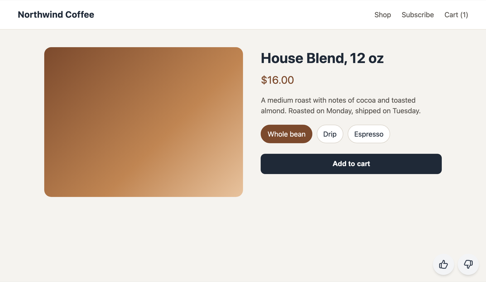
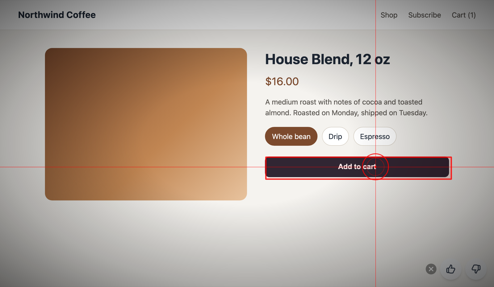
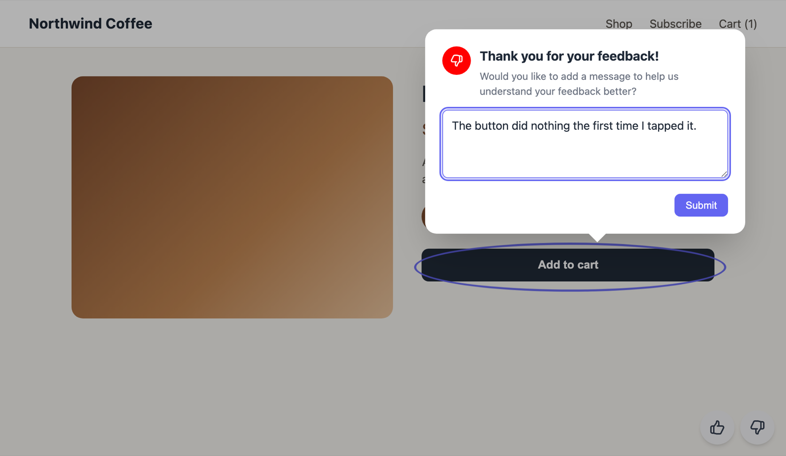

# @qaiddev/thumbs-embed

[](https://www.npmjs.com/package/@qaiddev/thumbs-embed)
[](https://github.com/qaiddev/thumbs-embed)

A zero-dependency, lightweight feedback embed that adds thumbs up/down buttons to any website. Users can optionally target specific page elements, leave messages, capture screenshots, mark them up and record short videos — all submitted to your API endpoint or the [QAid.dev hosted dashboard](https://qaid.dev).

It needs 11.5 KB (gzipped) to draw its buttons. The rest loads later, and only when needed — see [What loads when](#what-loads-when).



## Install

### npm

```bash
npm install @qaiddev/thumbs-embed
```

```typescript
import { QaidFeedback } from '@qaiddev/thumbs-embed';

const feedback = new QaidFeedback({
  endpoint: 'https://qaid.dev/api/feedback',
  apiKey: 'YOUR_API_KEY',
});
```

### CDN / Script Tag

```html
<script
  src="https://unpkg.com/@qaiddev/thumbs-embed/dist/embed.js"
  data-endpoint="https://qaid.dev/api/feedback"
  data-api-key="YOUR_API_KEY"
></script>
```

`embed.js` is a tiny classic loader that works in every browser: it feature-detects
ES-module support and pulls in the right build automatically — the **progressive
loader** (`loader.js`, a small core that only draws the buttons) on modern browsers,
or the all-in-one UMD bundle (`qaid.umd.cjs`) on older ones. The injected build
auto-initializes when it detects a `data-endpoint` attribute.

> Prefer to skip the loader's feature-detect hop? Point straight at
> `dist/loader.js` with `type="module"` (modern browsers only), or
> `dist/qaid.umd.cjs` as a classic script (works everywhere, no code-splitting).

### What loads when

Sizes are gzipped, for 1.13.

| When | Size | What it brings |
|------|------|----------------|
| Before paint | 0 KB | nothing; the tag waits (`defer`) |
| After paint | 14.4 KB | `embed.js`, `loader.js` and the core: draws the buttons |
| Pointer near the buttons, or browser idle | +11 KB | the message box, targeting and send code, so a click opens at once |
| Screenshot, as needed | +1 KB | the capture |
| Screenshot drawn from the page, first time | +47 KB | html2canvas, which ships inside the package |
| Markup, as needed | +4.3 KB | the markup editor |
| Video, as needed | +6.9 KB | the recorder |

A tag pinned with `integrity` loads differently: see [Security](#security-pinning-integrity-and-csp).

### JSON Config (Script Tag)

For complex configurations, use a separate JSON config element. Put it **right before or right after** the embed's script tag, or give it an `id` and name it on the tag with `data-config-id="…"`. A block anywhere else on the page is ignored, so markup injected elsewhere on your page can't redirect your feedback.

```html
<script type="application/json" data-feedback-config>
{
  "endpoint": "https://qaid.dev/api/feedback",
  "apiKey": "YOUR_API_KEY",
  "position": "bottom-left",
  "colors": {
    "positive": "#22c55e",
    "negative": "#ef4444",
    "marker": "#8b5cf6"
  },
  "text": {
    "modalTitle": "How are we doing?",
    "placeholder": "Tell us what you think..."
  }
}
</script>
<script src="https://unpkg.com/@qaiddev/thumbs-embed/dist/embed.js"></script>
```

## How It Works

1. Thumbs up/down buttons appear on your page
2. User clicks a thumb button
3. A targeting overlay activates — the user clicks on any page element to attach their feedback to it
4. Optional permission to save a screenshot of the current tab.
5. Feedback is submitted to your endpoint as a JSON POST, and a modal opens at the same moment where the user can leave a more detailed message. The modal does not wait for the POST to answer; a message the user sends goes out as a PATCH once the POST has returned its id.

Step 3, picking the part of the page the feedback is about:



Step 5, the message box, pointing at the picked element:



If `skipTargeting` is `true`, step 3 is skipped and the modal opens immediately.

If `captureScreenshot` is `false`, we skip step 4. 

## Configuration

All are optional except `endpoint`.  

We offer a Free Plan for a compatible endpoint and a dashboard to manage your site's feedback.

### Core Options

| Option | Type | Default | Description |
|--------|------|---------|-------------|
| `endpoint` | `string` | **(required)** | API endpoint URL for submitting feedback data |
| `apiKey` | `string` | `""` | API key for authenticating with the feedback service |
| `skipTargeting` | `boolean` | `false` | Skip element targeting and go directly to the feedback modal |

### Positioning

| Option | Type | Default | Description |
|--------|------|---------|-------------|
| `position` | `string` | `"bottom-right"` | Button position: `"bottom-right"`, `"bottom-left"`, `"top-right"`, `"top-left"` |
| `offset` | `{ x?: number, y?: number }` | `{ x: 16, y: 16 }` | Distance from viewport edge in pixels |
| `container` | `string` | `""` | CSS selector for a custom container element. When set, `position`, `offset`, and `zIndex` are ignored |
| `zIndex` | `number` | `50` | z-index for the embed elements |

### Appearance

| Option | Type | Default | Description |
|--------|------|---------|-------------|
| `buttonSize` | `string` | `"medium"` | Button size: `"small"` (36px), `"medium"` (48px), `"large"` (64px) |
| `buttonClass` | `string` | `""` | Custom CSS class for buttons. When set, default button styles are not applied |
| `incognito` | `boolean` | `false` | Buttons are invisible until hovered |
| `modalWidth` | `number` | `400` | Width of the feedback modal in pixels |
| `backdropOpacity` | `number` | `0.3` | Opacity of the dark backdrop behind the modal (0-1) |
| `fontFamily` | `string` | `"system-ui, -apple-system, sans-serif"` | Font family for all text |
| `fontSize` | `number` | `16` | Base font size in pixels. Every text size in the modal, success screen, tooltip, recording and annotation screens is a multiple of it |

### Colors

Pass a `colors` object to customize the color scheme:

```typescript
new QaidFeedback({
  endpoint: '/api/feedback',
  colors: {
    positive: 'rgb(0, 200, 83)',  // Thumbs up color (default: green)
    negative: 'rgb(255, 0, 0)',   // Thumbs down color (default: red)
    marker: '#6365f1',            // Selected element outline & submit button (default: indigo)
  },
});
```

Colors accept hex (`#ABC`, `#AABBCC`) or `rgb(r, g, b)` format.

### Custom Icons

Replace the default thumb icons with SVG strings:

```typescript
new QaidFeedback({
  endpoint: '/api/feedback',
  positiveIcon: '<svg viewBox="0 0 24 24">...</svg>',
  negativeIcon: '<svg viewBox="0 0 24 24">...</svg>',
});
```

Icons are not inserted as HTML. The embed reads the string and rebuilds it from an allowlist of SVG elements (`svg`, `g`, `path`, `circle`, `ellipse`, `rect`, `line`, `polyline`, `polygon`, `title`, `desc`, `defs`, gradients, `stop`, `clipPath`) and presentation attributes. Scripts, event handlers, links, `style`, `use`, `image` and `foreignObject` are dropped, and so is any `url(…)` that doesn't point at an id inside the icon. A string that isn't an `<svg>` shows the default icon.

### Text Customization

The message box's strings can be overridden via the `text` object:

```typescript
new QaidFeedback({
  endpoint: '/api/feedback',
  text: {
    tooltip: 'Any feedback? Click to start, Esc to cancel',
    modalTitle: 'Thank you for your feedback!',
    modalSubtitle: 'Would you like to add a message to help us understand your feedback better?',
    placeholder: 'Optional: Tell us more about your experience...',
    submitButton: 'Submit',
    skipButton: 'Skip',
    confirmationTitle: 'Thank you!',
    confirmationMessage: 'Your feedback has been received.',
    confirmationClose: 'Close',
    // Shown instead of the success screen when the server refuses the message
    // (any non-2xx reply) or cannot be reached.
    errorTitle: 'Message not sent',
    errorMessage: 'Something went wrong, so we did not get your message. Please try again later.',
  },
});
```

Strings are inserted as plain text, so `<`, `&` and quotes show exactly as written. Only the icon options (`positiveIcon`, `negativeIcon`, `feedbackIcon`, `recordIcon`) take markup.

### Screenshots

Enable automatic screenshot capture with feedback submissions:

```typescript
new QaidFeedback({
  endpoint: '/api/feedback',
  captureScreenshot: true,
  screenshotOptions: {
    quality: 0.8,      // WebP compression quality (0-1, default 0.8)
    maxWidth: 1280,    // Max screenshot width in pixels
    maxHeight: 800,    // Max screenshot height in pixels
  },
});
```

Screenshots use the browser's Screen Capture API. The user will see a permission dialog. If they decline or the API is unavailable, the feedback is still submitted without a screenshot.

### Linking buttons to quests

Instead of the optional message box, a button can open a **quest** — a short questionnaire powered by [`@qaiddev/quests-embed`](https://www.npmjs.com/package/@qaiddev/quests-embed). You can ask one set of questions after a thumbs-up, a different set after a thumbs-down, and another after a video recording is sent. The quest widget is loaded from a CDN once the page is idle, along with each linked quest's definition, so a click opens the quest at once with no server round trip; the thumbs bundle itself stays zero-dependency. If it can't load, the classic message box is shown instead.

```typescript
new QaidFeedback({
  endpoint: 'https://qaid.dev/api/feedback',
  apiKey: 'YOUR_API_KEY',
  captureVideo: true,
  quests: {
    // Base URL of the quest service. Required to enable the feature.
    base: 'https://qaid.dev/api/quests',
    up: 'QUEST_ID_FOR_THUMBS_UP',     // optional, per button
    down: 'QUEST_ID_FOR_THUMBS_DOWN',
    video: 'QUEST_ID_AFTER_VIDEO',
    // apiKey defaults to the top-level apiKey; override only if different.
    // moduleUrl overrides where the quests embed is loaded from: a
    // same-origin copy, or one exact release on unpkg.
  },
});
```

`base` is the only required field — omit a button's id to keep the normal message box for that button. The embed derives the quest definition URL (`{base}/{questId}/definition`) and the response endpoint (`{base}/responses`) from it, and passes the created feedback record's id to the quest so its answers are joined back to that feedback on the server.

By default the quests embed loads from one exact release, `https://unpkg.com/@qaiddev/quests-embed@1.12.0/dist/qaid-quests.js`, and its sha384 is checked before it runs. A custom `moduleUrl` is used only when it is on your page's own origin (self-hosting) or `https://unpkg.com/@qaiddev/quests-embed@<exact version>/…`; anything else, a floating `@1` included, is refused with a console warning and the default is used.

## Security: pinning, integrity and CSP

The embed runs on your page with your page's rights, so treat it like any other third-party script: pin it, hash it, and fence it in.

### Pin a version and check its hash

```html
<script
  src="https://unpkg.com/@qaiddev/thumbs-embed@1.14.0/dist/embed.js"
  integrity="sha384-1c4N028o6f0/52B7qANdh/hk3UYUia4Sw3DMEZw78EQgy3ikh9urXQyq1mgdGs8s"
  crossorigin="anonymous"
  defer
  data-endpoint="https://qaid.dev/api/feedback"
  data-api-key="YOUR_API_KEY"
></script>
```

- The `@1.14.0` pins the release. Without it unpkg serves the newest release, and a hash can never match for long.
- `integrity` is the sha384 of `dist/embed.js` for that release. It is in each release's notes; to work it out yourself: `curl -s https://unpkg.com/@qaiddev/thumbs-embed@1.14.0/dist/embed.js | openssl dgst -sha384 -binary | openssl base64 -A`.
- `crossorigin="anonymous"` is required for the browser to check a hash on a file from another origin.
- **What the one hash covers.** When the tag carries `integrity`, every file `embed.js` loads after itself is checked too, with hashes baked in when the release was built:
  - Browsers that enforce import-map `integrity` (Chrome 127+, Safari 18+, Firefox 138+) get the small code-split build (about 14 KB gzipped at start-up). `embed.js` adds an import map listing the sha384 of `loader.js` and every lazy chunk, and the browser refuses any chunk whose bytes differ.
  - Every other browser gets the single-file bundle `qaid.umd.cjs` (about 79 KB gzipped) with its own hash.
  - No browser says whether it enforces the map, so `embed.js` asks: the map also lists `integrity-probe.js` under a hash it can never have, and `embed.js` loads it first. A refusal means the check works; if it runs, the bundle is used instead. You will see one console line about the probe's digest. That line is expected.
  - The import map is an inline script. Under a CSP without `'unsafe-inline'` for scripts the map is blocked, the probe runs, and the single-file bundle is used: still fully checked, just larger.
  - A linked quest loads quests-embed 1.12.0, whose hash is also checked before it runs.

### Content Security Policy

A policy that lets the embed work and nothing else from its side:

```
script-src 'self' https://unpkg.com/@qaiddev/thumbs-embed@1.14.0/ https://unpkg.com/@qaiddev/quests-embed@1.12.0/;
style-src 'self' 'unsafe-inline';
connect-src 'self' https://qaid.dev;
img-src 'self' data: blob:;
media-src blob:;
trusted-types qaid-embed;
require-trusted-types-for 'script';
```

- `script-src`: the exact versioned folders, not all of unpkg. Leave out quests-embed if no button opens a quest. Self-host and `'self'` is enough.
- `style-src 'unsafe-inline'`: the embed styles itself with `<style>` elements inside its shadow roots, which CSP treats as inline styles.
- `connect-src`: the origin of `data-endpoint` (and `data-quest-base`, if different).
- `img-src data: blob:` and `media-src blob:`: screenshots and the video preview are shown from in-memory images and recordings.
- `trusted-types qaid-embed`: on a page that sets `require-trusted-types-for 'script'`, the embed sets every script URL through one Trusted Types policy named `qaid-embed`, which signs only URLs the embed worked out itself. List it in your `trusted-types` directive, or the embed prints a warning and does not load. quests-embed uses the same name, so one entry covers both. The embed writes no HTML strings (`innerHTML`): its UI and icons are built as DOM nodes.
- Screenshots drawn from the page (`screenshotMethod: "dom"`) use html2canvas, which writes HTML into a hidden copy of the page and so does not work under `require-trusted-types-for 'script'`. The browser's own screen capture (`"permission"`) does.

### Self-hosting the files

Copy the whole `dist/` folder from the npm package to one folder on your own origin and point the tag at that `embed.js`. It loads `loader.js` and `chunks/` (or `qaid.umd.cjs`, when pinned) from the same folder. To serve quests from your origin too, copy quests-embed's `dist/qaid-quests.js` and set `data-quest-module-url` to it. The integrity rules above still apply, with your own URLs.

## Script Tag Data Attributes

Every config option has a `data-*` attribute, so the script tag alone can set anything. If a JSON config block is also on the page, the block wins and the attributes are not read.

Boolean attributes turn on with `"true"`; any other value leaves the default. `data-annotate` is the exception: it is on by default, so only `"false"` changes it. Numbers are plain digits (`data-zindex="9001"`, `data-backdrop-opacity="0.5"`).

| Attribute | Maps To |
|-----------|---------|
| `data-endpoint` | `endpoint` (required) |
| `data-api-key` | `apiKey` |
| `data-container` | `container` |
| `data-button-class` | `buttonClass` |
| `data-direction` | `direction` |
| `data-position` | `position` |
| `data-offset-x` | `offset.x` |
| `data-offset-y` | `offset.y` |
| `data-zindex` | `zIndex` |
| `data-skip-targeting` | `skipTargeting` |
| `data-single-button` | `singleButton` |
| `data-feedback-mode` | `feedbackMode` |
| `data-positive-color` | `colors.positive` |
| `data-negative-color` | `colors.negative` |
| `data-marker-color` | `colors.marker` |
| `data-button-size` | `buttonSize` |
| `data-tooltip` | `text.tooltip` |
| `data-modal-title` | `text.modalTitle` |
| `data-modal-subtitle` | `text.modalSubtitle` |
| `data-placeholder` | `text.placeholder` |
| `data-submit-button` | `text.submitButton` |
| `data-skip-button` | `text.skipButton` |
| `data-positive-label` | `text.positiveLabel` |
| `data-negative-label` | `text.negativeLabel` |
| `data-record-label` | `text.recordLabel` |
| `data-dismiss-label` | `text.dismissLabel` |
| `data-feedback-label` | `text.feedbackLabel` |
| `data-confirmation-title` | `text.confirmationTitle` |
| `data-confirmation-message` | `text.confirmationMessage` |
| `data-confirmation-close` | `text.confirmationClose` |
| `data-error-title` | `text.errorTitle` |
| `data-error-message` | `text.errorMessage` |
| `data-hide-confirmation` | `hideConfirmation` |
| `data-modal-width` | `modalWidth` |
| `data-backdrop-opacity` | `backdropOpacity` |
| `data-font-family` | `fontFamily` |
| `data-font-size` | `fontSize` |
| `data-capture-screenshot` | `captureScreenshot` |
| `data-annotate` | `annotate` (`"false"` to turn off) |
| `data-annotation-color` | `annotationColor` |
| `data-annotation-palette` | `annotationPalette`: a JSON array (`'["#f00","#0f0"]'`) or a comma list (`"#f00, rgb(0, 128, 0), #00f"`) |
| `data-capture-video` | `captureVideo` |
| `data-video-max-duration` | `videoOptions.maxDuration` |
| `data-video-redaction` | `videoOptions.redaction` |
| `data-record-icon` | `recordIcon` |
| `data-incognito` | `incognito` |
| `data-hide-dismiss` | `hideDismiss` |
| `data-positive-icon` | `positiveIcon` |
| `data-negative-icon` | `negativeIcon` |
| `data-feedback-icon` | `feedbackIcon` |
| `data-hide-thumbs` | `hideThumbs` |
| `data-css` | `css` (wins over `data-css-selector`) |
| `data-css-selector` | `css`, taken from the `textContent` of the element this selector matches |
| `data-screenshot-method` | `screenshotMethod` |
| `data-screenshot-quality` | `screenshotOptions.quality` |
| `data-screenshot-max-width` | `screenshotOptions.maxWidth` |
| `data-screenshot-max-height` | `screenshotOptions.maxHeight` |
| `data-quest-base` | `quests.base` |
| `data-quest-up` | `quests.up` |
| `data-quest-down` | `quests.down` |
| `data-quest-video` | `quests.video` |
| `data-quest-api-key` | `quests.apiKey` |
| `data-quest-module-url` | `quests.moduleUrl` |
| `data-config-id` | (the `id` of this tag's JSON config block) |

A value the embed can't use is ignored with one `console.warn` naming the attribute, and the default stays. That covers a malformed `data-annotation-palette` and an empty screen-reader label (`data-positive-label=""` would leave the button with no accessible name).

## Custom Button Container

By default, the embed creates a fixed-position container in the viewport corner. To place the buttons inside your own element:

```html
<div id="my-feedback-spot"></div>

<script type="module">
import { QaidFeedback } from 'https://unpkg.com/@qaiddev/thumbs-embed/dist/loader.js';

new QaidFeedback({
  endpoint: '/api/feedback',
  container: '#my-feedback-spot',
});
</script>
```

When `container` is set, the `position`, `offset`, and `zIndex` options are ignored. You control the layout.

## Custom Button Styling

Use `buttonClass` to apply your own CSS instead of the default button styles:

```typescript
new QaidFeedback({
  endpoint: '/api/feedback',
  buttonClass: 'my-feedback-btn',
});
```

When `buttonClass` is provided, default button colors, sizing, and shadows are not applied. Structural styles (display, alignment, cursor) are still applied via `.qaid-btn-structural`. Your class controls everything visual.

```css
.my-feedback-btn {
  width: 40px;
  height: 40px;
  background: #1a1a2e;
  border: 2px solid #e94560;
  border-radius: 8px;
}

.my-feedback-btn:hover {
  background: #e94560;
}
```

## API

### Constructor

```typescript
const feedback = new QaidFeedback(config: FeedbackConfig);
```

### Methods

| Method | Description |
|--------|-------------|
| `destroy()` | Remove all DOM elements, event listeners, and injected styles. Safe to call multiple times. |

### Payload

The embed submits feedback in two steps:

**1. Initial submission** — `POST` to your endpoint:

```json
{
  "feedbackType": "up",
  "pageUrl": "https://example.com/page",
  "apiKey": "YOUR_API_KEY",
  "elementSelector": "body > main:nth-child(2) > button:nth-child(3)",
  "elementText": "Submit Order",
  "consoleErrors": [
    { "message": "TypeError: Cannot read properties of undefined", "timestamp": 1704067200000, "level": "error" }
  ],
  "screenWidth": 1920,
  "screenHeight": 1080,
  "clickX": 450,
  "clickY": 320,
  "scrollX": 0,
  "scrollY": 150,
  "screenshot": "data:image/webp;base64,...",
  "visitorId": "a1b2c3d4-...",
  "elementBounds": { "x": 400, "y": 300, "width": 120, "height": 40 },
  "userAgent": "Mozilla/5.0 ..."
}
```

Your endpoint should return `{ "id": 123 }`. It may also return `"editToken": "<random string>"`: the embed then sends it back on every PATCH for that record, so your server can refuse a PATCH from anyone who did not create it.

**2. Message update** — `PATCH` to `{endpoint}/{id}`:

```json
{
  "message": "The submit button doesn't work on mobile",
  "editToken": "<the token from the POST, when there was one>"
}
```

## Console Capture

The embed automatically captures up to 20 recent `console.error`, `console.warn`, and `console.log` calls during the user's session. These are included in the feedback payload as `consoleErrors`, giving you context about what went wrong before the user submitted feedback. Obvious secrets in them (Bearer tokens, JWTs, `password=…` pairs, long API keys, card numbers) are replaced with `[redacted]`, and each message is capped at 1,000 characters.

During a video recording the embed also notes failed network calls (4xx/5xx). It never keeps request bodies; it drops response bodies for 401/403 and for sign-in, auth, token, password, session and OAuth URLs; and it replaces credential-like query parameters (`token`, `key`, `secret`, `password`, `code`, `session`, `auth`, `sig` and similar) in the URLs it keeps.

Console methods are restored to their originals when `destroy()` is called.

## Element Targeting

When the user clicks on an element during targeting mode, the embed generates a stable CSS selector using this priority:

1. **Data attributes** — `data-comp`, `data-qa`, `data-testid`, `data-id` (checked on the element and its ancestors)
2. **Element ID** — e.g. `#submit-button`
3. **nth-child path** — e.g. `body > main:nth-child(2) > button:nth-child(3)` (always unique, always valid)

The first 100 characters of the element's text content are also captured.

## Responsive Behavior

- **Desktop**: The feedback modal is positioned near the selected element with an arrow pointing at the click location
- **Mobile** (viewport < 640px): The modal displays as a bottom sheet, sliding up from the bottom of the screen with safe-area inset support

## CSS Custom Properties

The embed injects CSS custom properties you can use or override:

```css
:root {
  --qaid-positive: rgb(0, 200, 83);
  --qaid-negative: rgb(255, 0, 0);
  --qaid-marker: #6365f1;
  --qaid-btn-size: 48px;
  --qaid-icon-size: 24px;
  --qaid-modal-width: 400px;
  --qaid-backdrop-opacity: 0.3;
  --qaid-font-family: system-ui, -apple-system, sans-serif;
  --qaid-font-size: 16px;
}
```

The embed also supports dark mode automatically via the `light-dark()` CSS function.

## Hosted Dashboard

[Qaid](https://qaid.dev) provides a hosted dashboard for managing feedback collected by this embed:

- **Feedback inbox** with archiving and admin notes
- **Project management** with multiple API keys
- **Team collaboration** with owners, members, and invitations
- **Browser context** — console errors, viewport info, user agent captured with each submission
- **Screenshot viewing** for visual bug reports
- **Analytics** and data retention

### Plans

| | Cadet (Free) | Commander ($9/seat/mo) | Admiral (Enterprise) |
|---|---|---|---|
| Projects | 1 | 10 | Unlimited |
| Feedback | 100/mo per project | 10,000/mo per project | Unlimited |
| Screenshots, console errors, video | - | Yes | Yes |
| Notifications | Email | Email, webhooks, Slack | Email, webhooks, Slack |
| Issues | GitHub, Linear, Jira | Plus AI PR fixes | Custom |

Full details at [qaid.dev/pricing](https://qaid.dev/pricing). Sign up at [qaid.dev](https://qaid.dev). You can also self-host — the embed works with any endpoint that accepts the payload format described above.

## Self-Hosting

The embed is endpoint-agnostic. Point it at your own server:

```typescript
new QaidFeedback({
  endpoint: 'https://your-server.com/api/feedback',
});
```

Your server needs to handle:

1. `POST /api/feedback` — Accept the feedback payload, return `{ "id": number }` (optionally with `"editToken": string`)
2. `PATCH /api/feedback/:id` — Accept `{ "message": string | null }` or `{ "feedbackType": "up" | "down" }`, plus `editToken` if the POST returned one

Answer the message `PATCH` with a 2xx status. Any other status shows the visitor the "Message not sent" screen instead of the success screen. Likewise, a non-2xx reply to the video upload (`POST {endpoint}/video`) keeps the recording preview open with an error.

## Project Badges

<a href="https://www.npmjs.com/package/@qaiddev/thumbs-embed">

</a> 

<a href="https://github.com/qaiddev/thumbs-embed/blob/prod/LICENSE">
  
</a>
